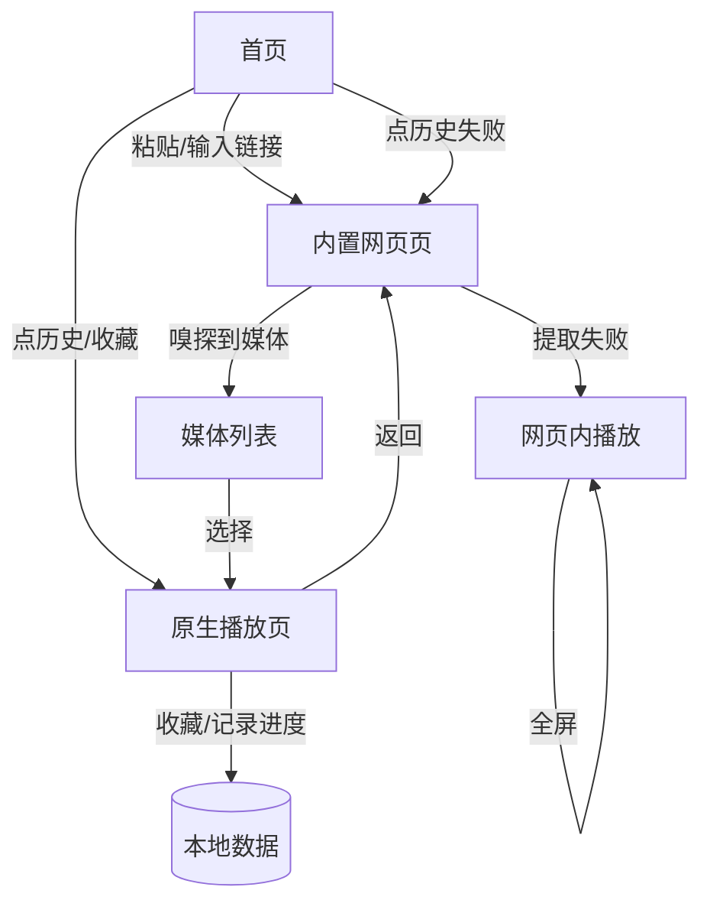

# 网页播放器（Android）设计规格

- 日期：2026-11-07
- 状态：待用户评审
- 暂定名称：网页播放器（可改）
- 暂定包名：`com.jqc.webplayer`（可改）
- 目标平台：Android 手机（用户真机为 Android 13–15），竖屏使用为主
- 交付形态：源码 + 可安装 APK + 中文构建/安装说明

## 1. 背景与目标

用户希望有一个安卓 App：把网页链接粘贴进去，打开网页；如果页面里有视频，优先提取视频直链用原生播放器播放，提取不了则在 App 内置网页里正常播放。

典型样本：`https://cj1nym.com/vod/play/147588/1/1324649`。

对该样本的只读探测结论：

- 链接 302 跳转到手机版 `m.cj1nym.com`，页面由 Next.js 构建。
- 视频地址不在初始 HTML 中，运行时由前端 JS 请求接口后交给播放器加载。
- 因此仅靠“扫描页面源码找 m3u8”不够，必须做“WebView 请求拦截 + JS 钩子”的组合嗅探。

产品定位：通用网页视频播放器，不针对特定站点做专属破解，不做 DRM 绕过，不提供下载。用户需自行确保观看内容的合法性。

## 2. 已确认需求

### 2.1 功能

- 粘贴/输入网页链接并打开。
- 自动嗅探网页中的视频资源（HLS m3u8、MP4、WebM）。
- 能提取时：用原生播放器播放。
- 提取失败时：退回 App 内置网页播放，支持网页视频全屏。
- 历史记录与收藏，本地保存，无需账号。
- 剪贴板链接提示：回到 App 时若剪贴板有 http(s) 链接，显示“打开剪贴板链接”的提示条；只提示，不自动跳转。
- 播放器基础能力：播放/暂停、进度拖动、快进快退、全屏、横屏、手势调亮度与音量、倍速、清晰度切换、画中画、收藏。
- 播放进度记忆与续播。
- 默认拦截网页弹窗广告；可切换桌面版 UA。

### 2.2 非目标（第一版明确不做）

- 下载视频。
- 系统分享入口（从其他 App 分享链接直接进入）。
- iOS / 桌面端。
- 账号、云同步。
- DRM（Widevine 等）绕过、会员加密内容破解。
- 通用去广告（只拦弹窗和新窗口，不做元素级广告过滤）。
- 后台音频播放、投屏、外挂字幕加载。
- 站点专属解析规则（不为单个站点写专用接口）。

## 3. 使用流程



### 3.1 首页

- 链接输入框 + “粘贴并打开”按钮；自动补全缺失的 `https://`；仅接受 http(s) 地址，其他内容直接提示无效。
- 剪贴板提示条：仅当剪贴板内容为合法 http(s) 链接且与输入框不同，显示“打开剪贴板链接”。
- “最近播放”“收藏”两个列表；空状态给出简短引导。
- 列表项显示标题、站点域名、最后观看时间；历史额外显示进度。

### 3.2 网页页

- 顶部工具栏：返回、当前地址（只读，点击可复制）、刷新、“媒体(N)”按钮、菜单。
- 菜单项：切换桌面版 UA、在系统浏览器打开、收藏此页。
- 嗅探在后台静默进行；首次发现媒体时展示悬浮提示“发现 N 个视频”，此后通过“媒体(N)”按钮进入列表。
- 媒体列表为底部弹层，条目展示：类型（HLS/MP4）、清晰度（能解析时）、来源域名；点击用原生播放器播放。
- 提取不到媒体时：不打断浏览，提示“未发现可播放视频，可继续在网页内播放”，并提供“重新嗅探”。
- 网页内视频全屏、横屏、屏幕常亮由 App 处理；弹窗与新窗口默认拦截。

### 3.3 播放页

- 独立 Activity，原生播放器 + 自定义控制层。
- 控件：播放/暂停、进度条（可拖动）、后退 10 秒、前进 10 秒、倍速（0.5x–2x）、清晰度（HLS 多码率时）、画中画（API 26+）、全屏/方向切换、收藏。
- 手势：横向拖动调进度；左半屏纵向调亮度；右半屏纵向调音量。
- 进入时若有历史进度且距结尾超过 10 秒，自动续播并提示“已从 12:34 继续”，提供“从头播放”。
- 每 5 秒及暂停/退出时保存进度。
- 播放失败时展示原因与处理动作，见第 8 节。

### 3.4 历史与收藏

- 历史按最后观看时间倒序；同一页面只保留一条，重复观看更新记录。
- 历史最多保留 200 条，超出删除最旧记录。
- 点击历史：优先用保存的视频地址原生播放；若失败，回网页重新嗅探并提示“链接已失效，正在重新加载网页”。
- 收藏可从网页页菜单或播放页添加；支持改名、删除。收藏不设上限。

## 4. 技术选型

| 项 | 选择 | 理由 |
|---|---|---|
| 语言/UI | Kotlin + Jetpack Compose | 原生能力完整，UI 开发效率高 |
| 网页容器 | Android WebView | 可拦截资源请求、共享 Cookie，支持网页兜底 |
| 播放器 | AndroidX Media3 ExoPlayer | 原生 HLS/MP4 支持，请求头可定制，支持画中画场景 |
| 请求头补全/清单解析 | OkHttp | 复用 WebView 的 Cookie/Referer/UA 请求清单 |
| 本地数据 | Room + DataStore | 历史/收藏结构化存储；设置项轻量存储 |
| 依赖注入 | 手写 AppContainer | 单模块小应用，避免 Hilt 增加复杂度 |
| 构建 | Gradle + AGP，JDK 21（Android Studio 自带 JBR） | 本机系统 Java 26 对 Gradle 过新，构建时固定使用 JBR |
| SDK | minSdk 26，compileSdk/targetSdk 35 | 覆盖 Android 13–15 真机，同时保留足够兼容性 |

## 5. 架构

单模块 App，包内分层，便于定位与维护。

```
com.jqc.webplayer
├── ui/            Compose 页面与主题
│   ├── home/      首页：输入、剪贴板提示、历史/收藏
│   ├── browser/   网页页：工具栏、媒体列表弹层、全屏容器
│   └── player/    播放页 UI 与控制层
├── browser/       WebView 封装、嗅探器、JS 桥、弹窗拦截
├── player/        PlayerActivity、ExoPlayer 控制器、进度保存
├── data/          Room 实体/DAO/数据库、仓库、DataStore 设置
├── core/          链接规范化、媒体分类、HLS 清单解析、请求头构造
└── AppContainer   手动依赖装配
```

- `MainActivity`：承载首页与网页页（Compose 内部导航）。
- `PlayerActivity`：承载原生播放与画中画，独立于 WebView 生命周期；网页保留在返回栈，退出播放可返回继续浏览。
- 页面状态由各页 ViewModel 持有；数据仓库为单例。

## 6. 嗅探与播放机制

### 6.1 三层嗅探

1. **请求拦截（主路径）**
   - 在 `WebViewClient.shouldInterceptRequest` 中读取请求 URL，不修改加载行为（返回 `null`）。
   - 命中规则：路径以 `.m3u8`、`.mp4`、`.webm` 结尾（忽略查询串影响）。
   - 忽略：`.ts`、`.m4s`、`.aac`、`.mp3`、`.vtt`、`.key` 等分片/附属资源；`blob:`、`data:`、`javascript:` 伪协议。
   - 结果放入并发安全的集合，去重、限流（最多保留 50 条，优先保留最新），通过 `StateFlow` 推给 UI。
   - 该回调在后台线程执行，只做字符串判断，不做网络请求，避免阻塞页面加载。

2. **JS 钩子（补充运行时接口）**
   - 页面开始加载时注入脚本（幂等，防重复注入）：
     - 包装 `window.fetch` 与 `XMLHttpRequest`，捕获请求地址与响应最终地址；
     - `MutationObserver` 监听 `<video>` / `<source>`，上报 `currentSrc`；
     - 正则扫描文档 HTML，上报被转义的 m3u8 地址。
   - 上报通过 `addJavascriptInterface` 的窄接口：`reportMedia(url, typeHint)`。
   - 桥接口只接收 http(s)、长度上限 4096 字符的 URL；不暴露文件、剪贴板或任意执行能力。
   - 只注入主文档；iframe 内的播放器仍由请求拦截层覆盖。

3. **清单补全与清晰度解析**
   - 发现 HLS 地址后，用 OkHttp 以 WebView 当前请求头拉取清单（超时 8 秒）。
   - 若为主清单（含 `#EXT-X-STREAM-INF`），解析分辨率与带宽，生成清晰度标签，供媒体列表展示与播放页切换。
   - 拉取失败不阻止用户点击播放，播放器仍会尝试，由异常流程兜底。

### 6.2 请求头透传（防盗链关键）

构造播放请求时带上：

- `User-Agent`：WebView 当前 UA。默认使用去掉 `; wv` 标记的手机 Chrome UA，避免站点区别对待；菜单可切换桌面版 UA。
- `Referer`：当前网页地址。
- `Origin`：当前网页的 scheme + host。
- `Cookie`：优先取 `CookieManager.getCookie(视频地址)`，并合并网页同域 Cookie。
- `Accept: */*`。

同一套请求头同时用于清单请求、HLS 分片请求与 MP4 播放（Media3 的 `DefaultHttpDataSource.Factory.setDefaultRequestProperties`）。

### 6.3 媒体分类与排序

- `m3u8` → HLS，优先级最高。
- `mp4` / `webm` → 渐进式，其次。
- 与网页同域或同主域的地址优先；含 `play`/`stream`/`video` 路径词的优先。
- 地址按完整 URL 去重；同一路径不同令牌视为不同地址，保留最新。
- 媒体列表展示来源域名，避免误点广告资源。

### 6.4 播放链路

1. 媒体列表点击 → 构造 `PlaybackRequest`（地址、类型、请求头、页面标题、页面地址、起始进度）。
2. `PlayerActivity` 接收参数，按类型创建：
   - HLS：`HlsMediaSource`，MIME 明确为 `application/x-mpegURL`；
   - MP4/WebM：`ProgressiveMediaSource`。
3. ExoPlayer 配置：音频焦点处理、耳机拔出暂停、超时与重试策略。
4. 清晰度切换：读取播放器当前轨道，构建可选列表；HLS 多码率时由轨道选择器切换。
5. 历史写入：成功起播（首帧渲染）后写入历史；播放中每 5 秒、暂停、`onStop`、退出时更新进度。
6. 画中画：`PlayerActivity` 进入 PiP，按视频宽高比设置参数；PiP 中隐藏自定义控件。

### 6.5 网页兜底

- WebView 设置：启用 JS、DOM Storage、数据库、第三方 Cookie；混合内容禁止；默认要求用户手势才允许媒体自动播放（减少广告噪音）。
- 允许 HTTP 明文流量（`usesCleartextTraffic=true`）：部分视频 CDN 与网页仍使用 http。这是自用工具的功能取舍，Cookie 可能经明文传输，不用于敏感账号场景。
- 弹窗拦截：`setSupportMultipleWindows(false)`，`onCreateWindow` 返回 false；`target=_blank` 尽量在当前窗口打开。
- 网页全屏：实现 `WebChromeClient.onShowCustomView/onHideCustomView`，用全屏容器覆盖，横屏、沉浸式、屏幕常亮，退出时恢复。
- 下载与外部协议（`intent://`、`market://`）默认拦截并提示“第一版不支持”。
- 证书错误：取消加载并提示，不静默忽略。
- 渲染进程崩溃：销毁并重建 WebView，恢复原地址，带防循环保护。
- 返回键：网页可后退则后退，否则回首页。

## 7. 数据模型

### 7.1 历史 `history`

| 字段 | 类型 | 说明 |
|---|---|---|
| id | Long | 主键自增 |
| pageUrl | String | 页面地址，唯一索引 |
| pageTitle | String | 页面标题 |
| siteHost | String | 站点域名（展示用） |
| videoUrl | String? | 最近播放的视频地址 |
| streamType | String? | HLS / MP4 / WEBM |
| qualityLabel | String? | 最近清晰度标签 |
| positionMs | Long | 观看进度 |
| durationMs | Long | 总时长 |
| updatedAt | Long | 最后观看时间 |

去重规则：以 `pageUrl` 唯一；重复播放更新视频地址、进度与时间。
进度规则：距结尾不足 10 秒视为看完，下次从头播放。

### 7.2 收藏 `favorites`

| 字段 | 类型 | 说明 |
|---|---|---|
| id | Long | 主键自增 |
| pageUrl | String | 页面地址，唯一索引 |
| title | String | 展示标题，可改名 |
| videoUrl | String? | 收藏时的视频地址（可为空） |
| createdAt | Long | 创建时间 |

### 7.3 设置 `DataStore`

- `blockPopups`：默认 true。
- `desktopUa`：默认 false。
- `preferBestQuality`：默认 true（媒体列表默认推荐最佳清晰度；不等于自动播放）。
- `rememberProgress`：默认 true。

## 8. 异常处理

| 场景 | 处理 |
|---|---|
| 网页加载失败 / 断网 | 显示错误与“重试”，保留历史与收藏 |
| 未嗅探到媒体 | 不打断浏览；提示可在网页内播放；提供“重新嗅探” |
| 播放失败（403/404/超时） | 播放页显示原因与动作：用网页播放、重新加载网页刷新令牌、复制地址 |
| 历史地址令牌过期 | 先试原生播放；失败回网页重新嗅探，提示“链接已失效，正在重新加载” |
| 不支持的编码/容器 | 提示原因并回网页播放 |
| 网页证书错误 | 取消加载并说明，不静默放行 |
| WebView 渲染进程崩溃 | 重建并恢复 URL，防循环 |
| 播放器解码错误 | 停止播放，保留进度，提示回网页 |
| 无可用网络 | 统一离线提示，禁止重复请求 |

原则：任何失败都不能让 App 卡死；优先保留“回网页看”的退路。

## 9. 测试与验收

### 9.1 单元测试（JVM）

- 媒体 URL 分类：HLS/MP4/WebM 识别；分片、广告、伪协议过滤。
- 清单解析：主清单变体、分辨率/带宽、非主清单。
- 请求头构造：Referer/Origin/Cookie 合并与缺失兜底。
- 链接规范化：补全 scheme、去掉首尾空白。
- 历史去重与进度规则（Room 内存库）。

### 9.2 本地验收页

在开发机启动一个局域网测试页，手机通过 Wi-Fi 访问，覆盖：

1. 普通 HTML5 `<video>` 直接加载 MP4；
2. 页面 JS `fetch` 接口返回 m3u8 地址后加载；
3. HLS 多码率清单；
4. 弹窗广告按钮与 `target=_blank` 链接；
5. 网页内全屏按钮。

该页面用于逐层验证三层嗅探、弹窗拦截与网页全屏，避免只依赖真实站点。

### 9.3 真机验收标准

1. 用样本链接：打开后能列出可播放媒体，点击后原生播放；暂停、拖动、横屏、画中画正常。
2. 在提取失败的站点上：网页内视频可全屏正常播放。
3. 历史续播误差 ≤5 秒；收藏在重启 App 后仍存在。
4. 广告多的页面冷启动与连续导航不崩溃，弹窗被拦截。
5. APK 在 Android 13–15 真机安装成功，数据重启不丢。
6. 历史中的过期链接能自动回退网页重嗅，不出现死循环。

### 9.4 真机测试清单

- 样本链接 + 2–3 个用户常用站点。
- 登录态站点（需在网页内登录后验证 Cookie 透传）。
- 直播 m3u8（少量验证）。

## 10. 构建与交付

- Gradle Wrapper 固定版本；`local.properties` 指向本机 SDK。
- 构建使用 Android Studio 自带 JDK 21：`/Applications/Android Studio.app/Contents/jbr/Contents/Home`。
- 需要安装 compileSdk 35 与对应 build-tools；构建前用 sdkmanager 补齐并接受许可。
- 产出：
  - `app-debug.apk`（开发验证）；
  - `app-release.apk`（本地生成签名密钥，便于覆盖升级；密钥不入库）。
- 安装：`adb install -r` 或传文件到手机安装（需允许未知来源）。
- 文档：`README.md` 说明构建、签名、安装、常见问题。

## 11. 风险与边界

| 风险 | 影响 | 应对 |
|---|---|---|
| 站点识别 WebView / UA 拦截 | 页面异常或拒绝播放 | 默认普通 Chrome UA；提供桌面版 UA；仍失败则依赖网页提示 |
| 视频地址带时效令牌 | 历史/收藏播放失败 | 回网页重嗅，后续播放自然刷新 |
| 纯 `blob:`/MSE 且网络层无清单 | 无法提取 | 网页内播放兜底 |
| 强 DRM / 会员加密 | 无法原生播放 | 明确不支持，网页内播放（是否可播由站点决定） |
| 站点 WAF/验证码 | 页面需人工操作 | 用户在网页内完成，Cookie 保留 |
| 广告/弹窗干扰 | 体验差 | 默认拦截弹窗与新窗口；不做元素级过滤 |
| HEVC/AV1 等编码 | 部分设备不能解 | 提示并回网页 |
| WebView 版本差异 | 嗅探结果不一致 | 三层嗅探互补；真机验收覆盖 Android 13–15 |
| 内容版权 | 合规风险 | 通用工具定位；不提供下载、不绕过 DRM；用户自行确保内容合法 |

## 12. 后续可扩展（不在本次范围）

- 系统分享入口。
- 下载可提取的视频。
- 站点适配插件（用户自行导入规则）。
- 播放列表/连续剧自动下一集。
- 外挂字幕、投屏。

以上均需另行确认后按新需求设计。
